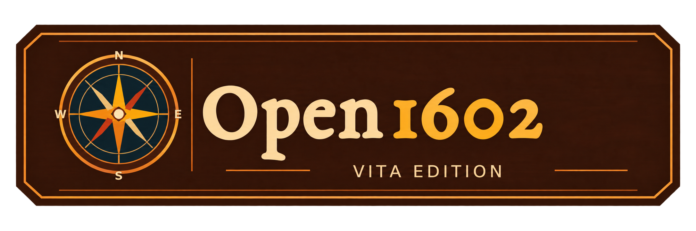

<p align="center">
  
</p>

# Open1602 for PlayStation Vita

This is a native Vita port of [Open1602](https://github.com/x4rd4s/open1602), the open-source engine for Anno 1602. It brings the familiar game interface and original graphics to the handheld, with controller and touchscreen support.

**You need your own original game files. No commercial game assets are included in this repository or the VPK.**

## Features

- Single-player endless games and scenarios.
- Map and scenario editor with creation, editing, saving and test play.
- Settlement building, production chains, trade, ships and computer opponents.
- Open1602's military and diplomacy systems.
- Music, sound effects, intros and event videos.
- Saving and loading.
- Controller and front touchscreen support.
- German and English interface texts.
- Multiplayer through LAN, local Ad-hoc, Direct-IP and an optional online server list and relay.
- Multiplayer lobby and in-game chat.

These features are part of the engine and port. Not every gameplay situation has been fully tested on Vita.

## Current limitations

FPS drops and short stutters can still occur, particularly when moving across developed islands, changing zoom levels or opening certain windows. A constant 60 FPS is not guaranteed.

Some missions, advanced gameplay systems, long sessions and multiplayer edge cases still need further testing. Bugs may still occur.

LAN and Ad-hoc have been tested on real Vitas during development. Online play across different Internet connections still needs broader testing.

The current build requests a CPU clock of **444 MHz** automatically.

## Download

Download the ready-to-install VPK from [Releases](https://github.com/Colie286/Open1602-Vita/releases). You do not need VitaSDK or the build tools to play.

The prebuilt VPK includes a configured master/relay server for the online game list and public games. It contains the game engine, project artwork and license notices, but **no original Anno 1602 game files**.

Each binary release also provides its matching source and licensing materials. See [Release sources and redistribution](#release-sources-and-redistribution) below.

## Building

### Requirements

- A Linux build environment; Windows users can use WSL2.
- Git.
- CMake **3.25 or newer**.
- Make or Ninja.
- Python 3 with **Pillow**.
- [VitaSDK](https://vitasdk.org/) with its standard libraries and a C++20-capable compiler. Development builds used GCC 15.2.

SDL3 and zlib are pinned submodules. The required Vita SDL patches are included.

### Build instructions

```sh
git clone --branch main --recurse-submodules https://github.com/Colie286/Open1602-Vita.git
cd Open1602-Vita

export VITASDK=/path/to/vitasdk

bash tools/vita/build-sdl3.sh
bash tools/vita/build.sh
```

Replace `/path/to/vitasdk` with your VitaSDK installation directory.

The resulting package is:

```text
build/vita/platform/vita/open1602.vpk
```

Original game files are not required to build the VPK.

The public `main` branch has no default master server configured. You can supply your own endpoint through `settings.cfg`. To rebuild a particular prebuilt release, use the source revision, release-specific configuration and dependency versions listed with that release.

## Installing on PS Vita

1. Download the VPK from [Releases](https://github.com/Colie286/Open1602-Vita/releases), copy it to your Vita and install it using VitaShell.
2. **Recommended:** Install [CapUnlocker by GrapheneCt](https://github.com/GrapheneCt/CapUnlocker) using the plugin's installation instructions, then reboot your Vita. The plugin is optional; see [Recommended plugin: CapUnlocker](#recommended-plugin-capunlocker) below.
3. Copy the required files from your own **Anno 1602 Königsedition or 1602 A.D. / GOG installation** into `ux0:data/open1602/original/`.
4. Launch **Open1602** from the LiveArea.
5. Let the initial graphics preparation finish. Valid cached data is reused on later starts, although some loading is still necessary.

**History Edition:** The History Edition should also work, except for its video files. This setup has not been fully verified on Vita. The directory layout below is for the classic Königsedition / 1602 A.D. data.

Place the files and folders directly inside `original/`, keeping their original names and contents:

```text
ux0:data/open1602/original/
├── haeuser.cod
├── figuren.cod
├── Text.cod
├── GFX/
├── MGFX/
├── SGFX/
├── ToolGfx/
├── Gaddata/
├── NORD/
├── SUED/
├── NORDNAT/
├── SUEDNAT/
├── NOKLIMA/
├── Szenes/
├── MUSIC8/
├── Samples/
├── Speech8/
└── VideoSmk/
```

Keep the original videos inside `VideoSmk/`, including `8.smk` for the startup logo and `58.smk` for the main intro.

Windows executables, DLLs, installers and editor files are not needed. These instructions target the Königsedition; do not mix files from different editions.

Back up existing saves and settings before replacing an existing installation.

### Recommended plugin: CapUnlocker

[CapUnlocker by GrapheneCt](https://github.com/GrapheneCt/CapUnlocker) is recommended but optional. It allows homebrew applications to use the normally reserved fourth CPU core.

The port checks the plugin configuration and whether that core is actually accessible before enabling additional worker use. It also runs without the plugin.

Follow the plugin's installation instructions and reboot after installation. CapUnlocker is not included with the port and does not guarantee a particular frame rate.

## Multiplayer

- **LAN:** Play with other devices on the same local network.
- **Ad-hoc:** Connect nearby Vitas without a router or Internet server.
- **Direct-IP:** Connect directly to a reachable game host. Internet hosts normally need UDP port **16020** forwarded.
- **Online server list and relay:** Host and join public games without forwarding ports on the players' routers. The prebuilt release VPK includes a default master/relay server.

Online browsing and relay games connect to that service. Availability depends on the service being online; LAN, Ad-hoc and Direct-IP do not require it. Relay game traffic passes through the server and is not end-to-end encrypted. Avoid using a game password that you also use for another service.

To use another server, create `ux0:data/open1602/settings.cfg` and add:

```ini
master_server = relay.example.org:16022
```

Replace the example with your own server's hostname or IPv4 address. To disable the online service, use:

```ini
master_server = off
```

The server software and its instructions are available on the [masterserver branch](https://github.com/Colie286/Open1602-Vita/tree/masterserver).

LAN, Ad-hoc and Direct-IP remain available without a master server. Use compatible Open1602 Vita builds and matching game data on all participating devices. This source uses game protocol 27 like the original open1602 v0.5. Connecting older version will not work, keep the game updated.

## Settings and bug reports

Menu changes are saved automatically in `ux0:data/open1602/menu-preferences.cfg`.

An optional, manually created `ux0:data/open1602/settings.cfg` can override individual settings. The game does not create this file automatically.

Diagnostic logging is disabled by default. To enable it for a bug report, add this line to `settings.cfg` and restart the game:

```ini
logging = on
```

When reporting a problem, include the port version, console model, steps to reproduce it and any available logs if needed.

## AI-assisted development

AI tools helped with complex programming tasks, bug investigation, code reviews, code comments and code quality checks. They were also used to refactor manually written code and develop build tools. The original Open1602 project also uses AI-assisted development.

Changes were checked through builds, automated tests, emulator testing and user testing on real hardware. These checks do not guarantee that every bug has been found.

The project logo and LiveArea artwork were also generated with AI and supplied for redistribution with the project.

## Credits, dependencies and licenses

This port builds on the work of the original [Open1602 project](https://github.com/x4rd4s/open1602), the VitaSDK community and the following projects:

| Component | License |
|---|---|
| Open1602 and the Vita port | GPL-3.0-or-later |
| SDL3, including the Vita backend | zlib |
| zlib | zlib |
| ENet | MIT |
| Lua | MIT |
| dav1d | BSD-2-Clause |
| Opus | BSD-3-Clause |
| stb_vorbis | MIT or Unlicense |
| dr_flac | MIT-0 or Unlicense |
| Librempeg-derived video decoder code | GPL-3.0-or-later |
| FFmpeg-derived audio and transform code | LGPL-2.1-or-later, incorporated into this GPL port |
| Upstream Open1602 window and UI icons | CC0 1.0 |
| Project logo and LiveArea artwork | GPL-3.0-or-later |
| SDK runtime components | Various licenses; see the bundled notices |
| CapUnlocker, optional and not bundled | MIT |

See [LICENSE](LICENSE) and the files under [platform/vita/licenses](platform/vita/licenses) for attribution, full notices and dependency source references.

## Release sources and redistribution

Open1602 Vita is distributed under **GPL-3.0-or-later**. The included third-party components retain their respective licenses and copyright notices.

Each prebuilt VPK release is accompanied on the same [Releases page](https://github.com/Colie286/Open1602-Vita/releases) by:

- The exact port source revision and any release-specific changes or configuration, including the default master/relay endpoint.
- A corresponding-source bundle containing the port sources, required bundled and submodule library sources, applied patches and build scripts.
- The relevant license and copyright notices, plus SDK/dependency version references and instructions or materials needed to rebuild and relink the statically linked LGPL components with modified versions.

The VPK contains license notices under `licenses/`. Dependency notices and source references are also available in [platform/vita/licenses/ThirdParty.txt](platform/vita/licenses/ThirdParty.txt) and [platform/vita/licenses/SOURCES.txt](platform/vita/licenses/SOURCES.txt).

Use the corresponding-source bundle linked with the particular VPK release. GitHub's automatically generated source archives do not include submodule contents and are not a substitute for that complete bundle.

You may use, modify and redistribute the port under its applicable licenses. If you redistribute a VPK, preserve the notices and provide the matching corresponding source and any required LGPL relinking materials in accordance with those licenses. The software is provided without warranty; see [LICENSE](LICENSE).

Original game files are not part of the release. This project's licenses do not grant permission to redistribute them.

Anno is a trademark of Ubisoft. This is an independent community project and is not affiliated with or endorsed by Ubisoft, Max Design or Sunflowers. Original game assets remain the property of their respective owners and are not covered by this project's license.
